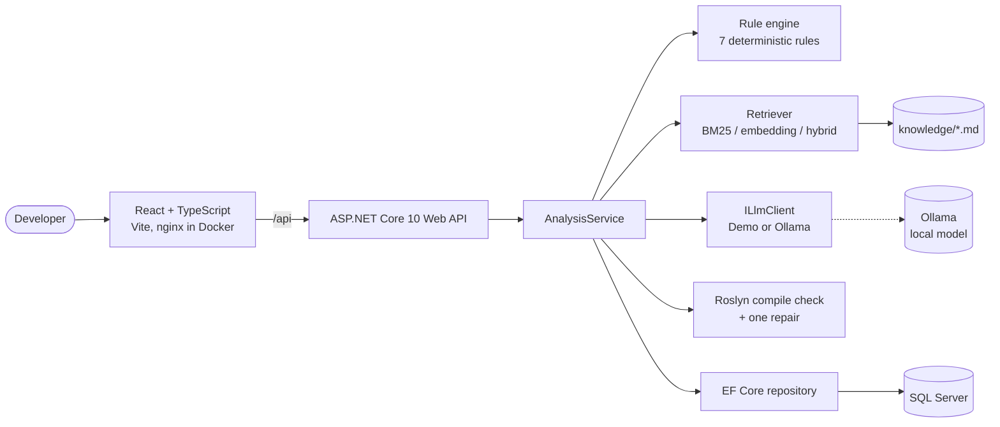
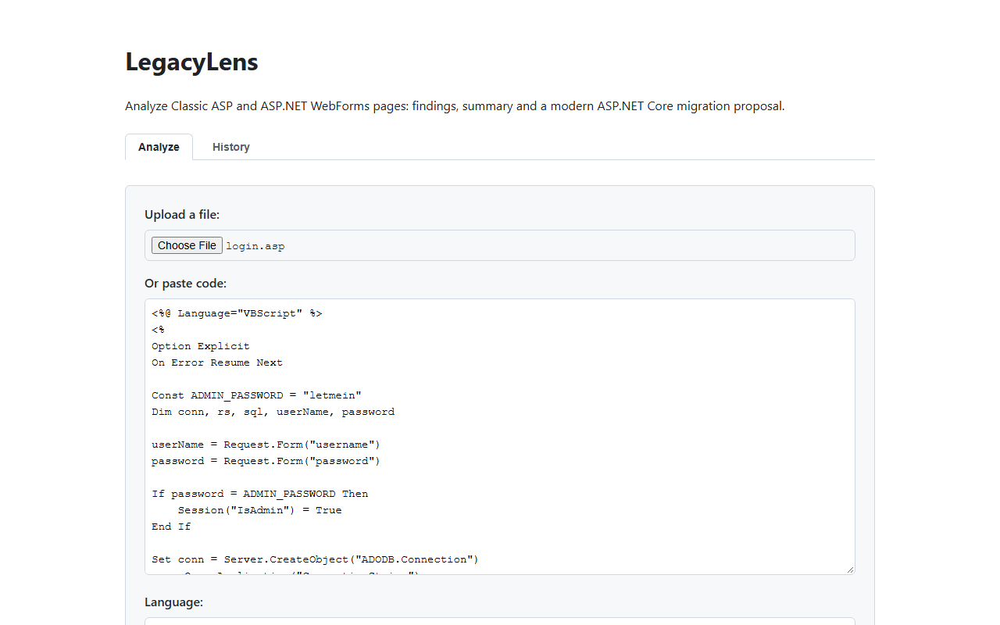
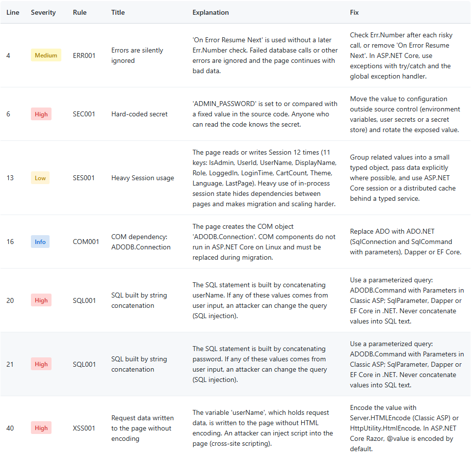

# LegacyLens

[](https://github.com/davidvr1/legacy-lens/actions/workflows/ci.yml)

AI-assisted Classic ASP / ASP.NET WebForms modernization helper. Paste a legacy page, get a summary, a list of security and quality findings, and a proposed ASP.NET Core implementation.


See [SPEC.md](SPEC.md) for the full design and build stages.

## The problem

Many companies still run Classic ASP and WebForms pages that nobody wants to touch: SQL built from request data, hard-coded passwords, `On Error Resume Next`, COM objects and includes everywhere. Before you can migrate a page, you need to know what it does and what is risky in it. LegacyLens does that first pass and drafts the modern version.

## Design: rules first, AI second, then validate

- **Deterministic rules are the source of truth.** Seven rules (SQL injection, XSS, secrets, error handling, COM, Session, includes) find risks with line numbers. They are fast, testable and measured by an eval (precision/recall below). The AI never adds or removes a rule finding.
- **The AI explains and drafts.** A local model (Ollama, free) writes the summary and the migration proposal. Every call asks for JSON that matches a schema. An invalid reply gets one retry with the error, and after that a clear error. The rest of the result is still returned.
- **Grounding.** The migration prompt includes the most relevant notes from `knowledge/` (BM25 retrieval). The model must cite the note ids it used, and only ids that were really in the prompt are shown as sources.
- **Validation.** The generated C# is compiled with Roslyn. If it fails, the model gets one repair attempt with the compiler errors. The UI shows **Compiles ✓** or the remaining errors.
- **Measured, not assumed.** Three eval levels: rules and retrieval run in CI, and the LLM eval runs by hand on a local model. The defaults come from a tuning sweep.
- **Zero cost.** Demo mode (the default) needs no model. The real model runs locally via Ollama. No paid API is used anywhere.

## Architecture



One analysis: rules, then two branches in parallel, the summary (LLM) and retrieval → migration (LLM) → compile check (and one repair), then save. `LegacyLens.Core` holds the domain, the rules and the orchestration behind interfaces (`IRule`, `ILlmClient`, `IRetriever`, `ICodeValidator`, `IAnalysisRepository`). `LegacyLens.Infrastructure` implements them with Ollama, EF Core and Roslyn. The API only wires things up.

| Analyze | Findings |
|---|---|
|  |  |
| **Summary** | **Migration proposal** |
|  |  |


The screenshots and the GIF are made by a Playwright script against the real app in Demo mode, so they stay current: `cd web && npm run screenshots` (writes `docs/images/`).

## Quick start with Docker

Needs only Docker. It runs the API, the web app and SQL Server, in Demo mode:

```bash
docker compose up --build
```

Open http://localhost:8088, upload a file from `samples/` (for example `samples/login.asp`) and click **Analyze**. The API is also reachable directly on port 5080, under `/api` only (for example http://localhost:5080/api/health); `/` returns 404. Swagger is only enabled when you run the API locally in Development (`dotnet run`), not in Docker. Change the ports with `WEB_PORT` and `API_PORT`. The SQL Server password is a local default for the throwaway container; set `MSSQL_SA_PASSWORD` to change it. Data is kept in the `sqldata` volume (`docker compose down -v` removes it).

With a real local model (free; on a CPU-only machine it is slow):

```bash
LLM_PROVIDER=Ollama docker compose --profile ollama up --build -d
docker compose exec ollama ollama pull qwen2.5-coder:3b
```

The `ollama` service is pinned to `ollama/ollama:0.40.16`; change the tag in `docker-compose.yml` to upgrade. Ollama already installed on your machine? Skip the profile and point the API at it: `LLM_PROVIDER=Ollama OLLAMA_URL=http://host.docker.internal:11434 docker compose up --build`.

## Evaluation results

| Level | What | Where it runs | Result |
|---|---|---|---|
| 1 Rules | 12 hand-written cases in `evals/rules/`, 31 expected findings | CI (`dotnet test`) | precision **1.000**, recall **0.968** |
| 2 Retrieval | 22 queries in `evals/retrieval.json` | CI (BM25) + manual (embedding, hybrid) | BM25 recall@3 **1.000**, MRR 0.955 |
| 3 LLM | 7 cases in `evals/llm/`, 3 runs per configuration | manual, local Ollama | fact recall **0.80**, hallucination **0.00**, compile after repair **0.43** (latest run, .NET 10) |

Details for levels 2 and 3 are in the Stage 4 and Stage 5b sections of the [build log](docs/BUILD_LOG.md), including the [tuning results](docs/BUILD_LOG.md#tuning-results). The latest re-run, after the move to .NET 10, is at the end of the build log.

### Rule eval (level 1)

Each case in `evals/rules/<case>/` is an `input.*` file and an `expected.json` with the findings a careful reviewer expects (`{ "ruleId": "SQL001", "line": 9 }`). The expected findings were written by hand from the code, not copied from the engine output. A finding counts as correct only with the right rule *and* line. The cases include traps that must **not** be flagged: parameterized queries, encoded output (`Server.HTMLEncode`, `<%: %>`), secrets in comments, code-like text inside strings and HTML, and a numeric cast (`CLng(Request(...))`).

```bash
dotnet run --project tools/LegacyLens.Evals -- rules
```

| Rule | TP | FP | FN | Precision | Recall |
|---|---|---|---|---|---|
| COM001 | 6 | 0 | 0 | 1.000 | 1.000 |
| ERR001 | 1 | 0 | 0 | 1.000 | 1.000 |
| INC001 | 4 | 0 | 0 | 1.000 | 1.000 |
| SEC001 | 4 | 0 | 0 | 1.000 | 1.000 |
| SES001 | 1 | 0 | 0 | 1.000 | 1.000 |
| SQL001 | 7 | 0 | 0 | 1.000 | 1.000 |
| XSS001 | 7 | 0 | 1 | 1.000 | 0.875 |
| **All** | 30 | 0 | 1 | 1.000 | 0.968 |

The one miss is on purpose: the case `known-limits` passes request data through two variables and a function (`raw = Request(...)`, `clean = Trim(raw)`, `Response.Write clean`). XSS001 follows a value through one assignment, but not through a chain of them. A CI test requires precision ≥ 0.95 and recall ≥ 0.9, and pins this known miss, so a rule change that fixes it updates the test on purpose. The cases were written by the same person who wrote the rules, so these numbers show the rules work on the patterns they target. They are not a measure on real-world code.

## Lessons learned

- **Small models copy whatever the prompt shows them.** The first summary prompt gave format examples ("Form: email"), and the 1.5b model put them into every answer. Hallucination was 0.29. With the examples removed, it dropped to about 0.01. The few-shot example cited a placeholder note id, and the model cited it too. Only the eval made these visible; reading a few answers by hand looked fine.
- **A JSON schema does not make the code inside valid.** The most common compile error was an unescaped `"` that ended the JSON string in the middle of the C# code. Structured output, the compile check and one repair attempt are separate safety nets, and each one catches things the others miss. Even so, only about half of the 3b migrations compile, so the UI shows the compiler result instead of claiming success.
- **Do not trust what the model says it used.** Models sometimes cite note ids that were not in the prompt. Those are dropped, and only the notes really retrieved are shown as sources.
- **The hardware picks the model.** 7b had the best fact recall but took over 5 minutes per analysis on a 4 GB GPU. 3b with a few-shot prompt was the best trade-off. A token cap (`NumPredict`) stops a small model that keeps generating, so it fails fast instead of hitting the timeout.
- **Measure spread, and be honest about sample size.** At temperature 0 the 3 runs were identical. At 0.2 they were not, and with 7 cases, most differences between configurations are within that spread. The README calls those choices indicative, not significant.
- **A perfect score on your own test set is a warning sign.** The first rule eval scored 1.000 everywhere. Adding a case aimed at a documented weakness (data passed through a chain of variables) showed the real limit, and a test now pins it.
- **Deterministic first keeps the AI honest.** Findings come only from rules, which are tested and measured. The model explains and drafts, but it cannot add or hide a security finding.

## Build log

The stage-by-stage history (what each stage added, the LLM tuning results and what the evals found) is in [docs/BUILD_LOG.md](docs/BUILD_LOG.md).

## Database

| Setting | Default | Meaning |
|---|---|---|
| `ConnectionStrings:LegacyLens` | `Server=(localdb)\MSSQLLocalDB;Database=LegacyLens;…` | SQL Server connection string. LocalDB comes with Visual Studio or SQL Server Express. |
| `Database:MigrateOnStartup` | `true` | Apply EF Core migrations when the API starts |

Any SQL Server works, for example in Docker (free Developer edition):

```bash
docker run -e ACCEPT_EULA=Y -e MSSQL_SA_PASSWORD='<your password>' -p 1433:1433 -d mcr.microsoft.com/mssql/server:2022-latest
# then start the API with:
ConnectionStrings__LegacyLens="Server=localhost,1433;Database=LegacyLens;User Id=sa;Password=<your password>;TrustServerCertificate=True"
```

Add a migration after a model change:

```bash
dotnet ef migrations add <Name> --project src/LegacyLens.Infrastructure --startup-project src/LegacyLens.Api --output-dir Persistence/Migrations
```

## LLM configuration

Set in `src/LegacyLens.Api/appsettings.json` or with environment variables (for example `Llm__Provider=Ollama`):

| Setting | Default | Meaning |
|---|---|---|
| `Llm:Provider` | `Demo` | `Demo` (canned answers) or `Ollama` (local model) |
| `Llm:Model` | `qwen2.5-coder:3b` | Ollama model name (chosen in Stage 5b) |
| `Llm:OllamaUrl` | `http://localhost:11434` | Ollama server address |
| `Llm:TimeoutSeconds` | `120` | Timeout for one model call |
| `Llm:Temperature` / `Llm:TopP` / `Llm:NumCtx` | `0.2` / `0.9` / `8192` | Sampling settings sent to Ollama |
| `Llm:NumPredict` | `2048` | Maximum reply tokens per call |
| `Llm:PromptVariant` | `FewShot` | `ZeroShot` or `FewShot` (one worked example in the prompt) |
| `Retrieval:Mode` | `Bm25` | `Bm25`, `Embedding` or `Hybrid` |
| `Retrieval:TopK` / `K1` / `B` | `3` / `1.2` / `0.75` | Chunks per prompt and BM25 parameters |
| `Retrieval:EmbeddingModel` | `nomic-embed-text` | Ollama embedding model |

To use a real local model (free): install [Ollama](https://ollama.com), run `ollama pull qwen2.5-coder:3b`, then start the API with `Llm__Provider=Ollama`.

## Repository layout

```
src/
  LegacyLens.Api/            ASP.NET Core 10 Web API
  LegacyLens.Core/           Domain models, interfaces, rule engine, orchestration
  LegacyLens.Infrastructure/ EF Core, LLM client, retriever, Roslyn compile check
tests/
  LegacyLens.Core.Tests/     xUnit unit tests
  LegacyLens.Api.Tests/      Integration tests (WebApplicationFactory)
web/                         React + TypeScript (Vite)
web/e2e/                     Playwright end-to-end UI tests
web/docs/                    Playwright script for the README screenshots and GIF
docs/images/                 README screenshots and GIF (generated)
knowledge/                   Migration notes used by the retriever
evals/                       Eval data: rule cases in rules/, retrieval queries, LLM cases in llm/, results in results/
docker-compose.yml           api + web + sqlserver (+ optional ollama profile)
tools/LegacyLens.Evals/      Eval console app (manual, local Ollama)
samples/                     Hand-written legacy sample pages
.claude/agents/              Claude Code agent roles (developer, QA)
```

## Prerequisites

For Docker, see [Quick start with Docker](#quick-start-with-docker). To run without Docker:

- .NET 10 SDK
- Node.js 20+ and npm
- SQL Server: LocalDB (default connection string) or any SQL Server instance, see [Database](#database)

## Run locally

API (http://localhost:5080, Swagger at `/swagger`):

```bash
dotnet run --project src/LegacyLens.Api
```

Web app (http://localhost:5173, with the API running):

```bash
cd web
npm install
npm run dev
```

Open http://localhost:5173, upload a file from `samples/` (for example `samples/login.asp`) and click **Analyze**.

## Build and test

```bash
dotnet build
dotnet test

cd web
npm run lint
npm run build
```

End-to-end tests (Playwright starts the API and the web app itself; locally it runs Chromium, Firefox and WebKit):

```bash
cd web
npx playwright install   # first time only: downloads the browsers
npx playwright test
```
