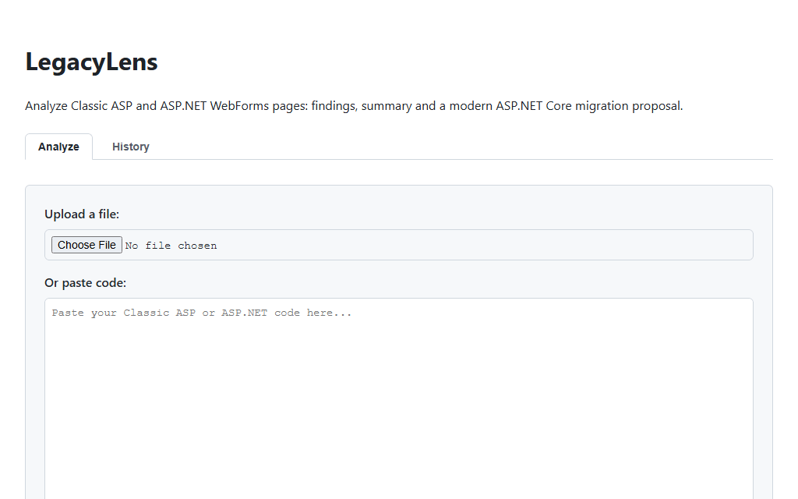
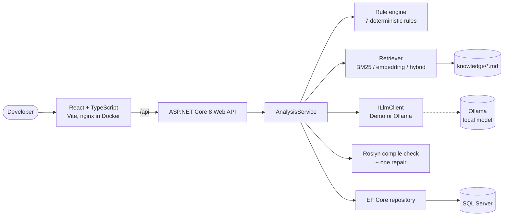
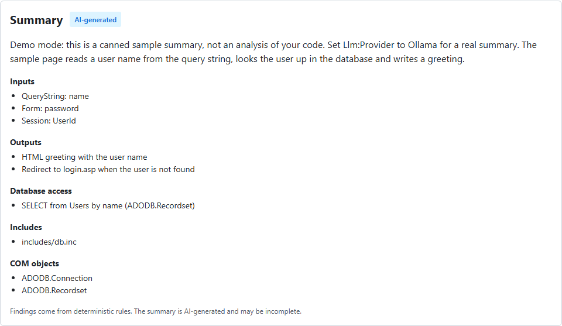
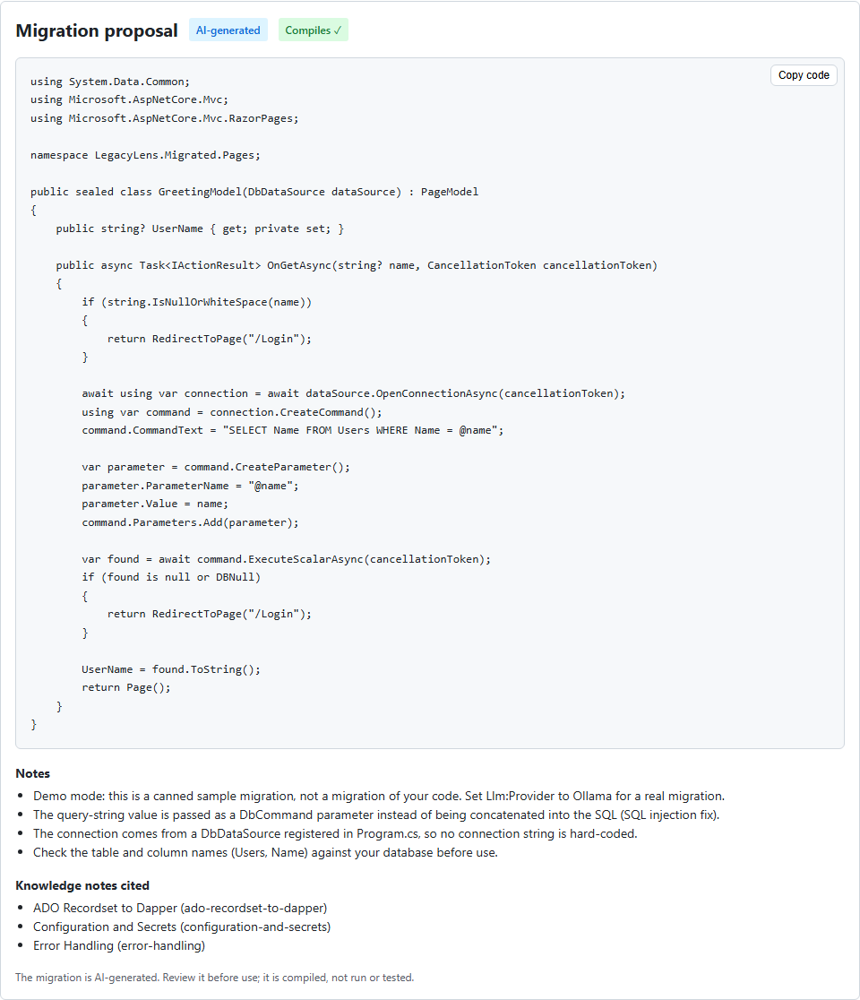
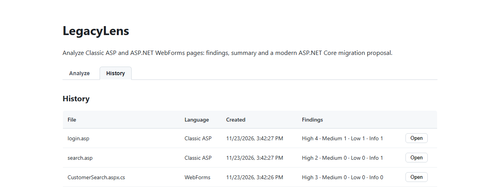

# LegacyLens

[](https://github.com/davidvr1/legacy-lens/actions/workflows/ci.yml)

AI-assisted Classic ASP / ASP.NET WebForms modernization helper. Paste a legacy page, get a summary, a list of security and quality findings, and a proposed ASP.NET Core implementation.



See [SPEC.md](SPEC.md) for the full design and build stages.

## The problem

Many companies still run Classic ASP and WebForms pages that nobody wants to touch: SQL built from request data, hard-coded passwords, `On Error Resume Next`, COM objects and includes everywhere. Before you can migrate a page, you need to know what it does and what is risky in it. LegacyLens does that first pass and drafts the modern version.

## Design: rules first, AI second, then validate

- **Deterministic rules are the source of truth.** Seven rules (SQL injection, XSS, secrets, error handling, COM, Session, includes) find risks with line numbers. They are fast, testable and measured by an eval (precision/recall below). The AI never adds or removes a rule finding.
- **The AI explains and drafts.** A local model (Ollama, free) writes the summary and the migration proposal. Every call asks for JSON that matches a schema. An invalid reply gets one retry with the error, and after that a clear error. The rest of the result is still returned.
- **Grounding.** The migration prompt includes the most relevant notes from `knowledge/` (BM25 retrieval). The model must cite the note ids it used, and only ids that were really in the prompt are shown as sources.
- **Validation.** The generated C# is compiled with Roslyn. If it fails, the model gets one repair attempt with the compiler errors. The UI shows **Compiles ✓** or the remaining errors.
- **Measured, not assumed.** Three eval levels: rules and retrieval run in CI, and the LLM eval runs by hand on a local model. The defaults come from a tuning sweep.
- **Zero cost.** Demo mode (the default) needs no model. The real model runs locally via Ollama. No paid API is used anywhere.

## Architecture



One analysis: rules → summary (LLM) → retrieval → migration (LLM) → compile check (and one repair) → save. `LegacyLens.Core` holds the domain, the rules and the orchestration behind interfaces (`IRule`, `ILlmClient`, `IRetriever`, `ICodeValidator`, `IAnalysisRepository`). `LegacyLens.Infrastructure` implements them with Ollama, EF Core and Roslyn. The API only wires things up.

| Analyze | Findings |
|---|---|
|  |  |
| **Summary** | **Migration proposal** |
|  |  |



The screenshots and the GIF are made by a Playwright script against the real app in Demo mode, so they stay current: `cd web && npm run screenshots` (writes `docs/images/`).

## Quick start with Docker

Needs only Docker. It runs the API, the web app and SQL Server, in Demo mode:

```bash
docker compose up --build
```

Open http://localhost:8088, upload a file from `samples/` (for example `samples/login.asp`) and click **Analyze**. The API is also reachable directly on port 5080, under `/api` only (for example http://localhost:5080/api/health); `/` returns 404. Swagger is only enabled when you run the API locally in Development (`dotnet run`), not in Docker. Change the ports with `WEB_PORT` and `API_PORT`. The SQL Server password is a local default for the throwaway container; set `MSSQL_SA_PASSWORD` to change it. Data is kept in the `sqldata` volume (`docker compose down -v` removes it).

With a real local model (free; on a CPU-only machine it is slow):

```bash
LLM_PROVIDER=Ollama docker compose --profile ollama up --build -d
docker compose exec ollama ollama pull qwen2.5-coder:3b
```

Ollama already installed on your machine? Skip the profile and point the API at it: `LLM_PROVIDER=Ollama OLLAMA_URL=http://host.docker.internal:11434 docker compose up --build`.

## Evaluation results

| Level | What | Where it runs | Result |
|---|---|---|---|
| 1 Rules | 12 hand-written cases in `evals/rules/`, 31 expected findings | CI (`dotnet test`) | precision **1.000**, recall **0.968** |
| 2 Retrieval | 22 queries in `evals/retrieval.json` | CI (BM25) + manual (embedding, hybrid) | BM25 recall@3 **1.000**, MRR 0.955 |
| 3 LLM | 7 cases in `evals/llm/`, 3 runs per configuration | manual, local Ollama | fact recall **0.80**, hallucination **0.00**, compile after repair **0.43–0.48** |

Details for levels 2 and 3 are in the Stage 4 and Stage 5b sections below.

### Rule eval (level 1)

Each case in `evals/rules/<case>/` is an `input.*` file and an `expected.json` with the findings a careful reviewer expects (`{ "ruleId": "SQL001", "line": 9 }`). The expected findings were written by hand from the code, not copied from the engine output. A finding counts as correct only with the right rule *and* line. The cases include traps that must **not** be flagged: parameterized queries, encoded output (`Server.HTMLEncode`, `<%: %>`), secrets in comments, code-like text inside strings and HTML, and a numeric cast (`CLng(Request(...))`).

```bash
dotnet run --project tools/LegacyLens.Evals -- rules
```

| Rule | TP | FP | FN | Precision | Recall |
|---|---|---|---|---|---|
| COM001 | 6 | 0 | 0 | 1.000 | 1.000 |
| ERR001 | 1 | 0 | 0 | 1.000 | 1.000 |
| INC001 | 4 | 0 | 0 | 1.000 | 1.000 |
| SEC001 | 4 | 0 | 0 | 1.000 | 1.000 |
| SES001 | 1 | 0 | 0 | 1.000 | 1.000 |
| SQL001 | 7 | 0 | 0 | 1.000 | 1.000 |
| XSS001 | 7 | 0 | 1 | 1.000 | 0.875 |
| **All** | 30 | 0 | 1 | 1.000 | 0.968 |

The one miss is on purpose: the case `known-limits` passes request data through two variables and a function (`raw = Request(...)`, `clean = Trim(raw)`, `Response.Write clean`). XSS001 follows a value through one assignment, but not through a chain of them. A CI test requires precision ≥ 0.95 and recall ≥ 0.9, and pins this known miss, so a rule change that fixes it updates the test on purpose. The cases were written by the same person who wrote the rules, so these numbers show the rules work on the patterns they target. They are not a measure on real-world code.

## Lessons learned

- **Small models copy whatever the prompt shows them.** The first summary prompt gave format examples ("Form: email"), and the 1.5b model put them into every answer. Hallucination was 0.29. With the examples removed, it dropped to about 0.01. The few-shot example cited a placeholder note id, and the model cited it too. Only the eval made these visible; reading a few answers by hand looked fine.
- **A JSON schema does not make the code inside valid.** The most common compile error was an unescaped `"` that ended the JSON string in the middle of the C# code. Structured output, the compile check and one repair attempt are separate safety nets, and each one catches things the others miss. Even so, only about half of the 3b migrations compile, so the UI shows the compiler result instead of claiming success.
- **Do not trust what the model says it used.** Models sometimes cite note ids that were not in the prompt. Those are dropped, and only the notes really retrieved are shown as sources.
- **The hardware picks the model.** 7b had the best fact recall but took over 5 minutes per analysis on a 4 GB GPU. 3b with a few-shot prompt was the best trade-off. A token cap (`NumPredict`) stops a small model that keeps generating, so it fails fast instead of hitting the timeout.
- **Measure spread, and be honest about sample size.** At temperature 0 the 3 runs were identical. At 0.2 they were not, and with 7 cases, most differences between configurations are within that spread. The README calls those choices indicative, not significant.
- **A perfect score on your own test set is a warning sign.** The first rule eval scored 1.000 everywhere. Adding a case aimed at a documented weakness (data passed through a chain of variables) showed the real limit, and a test now pins it.
- **Deterministic first keeps the AI honest.** Findings come only from rules, which are tested and measured. The model explains and drafts, but it cannot add or hide a security finding.

## Build log

**Stage 0 – Scaffold** (done)

What works now:
- .NET 8 solution with `LegacyLens.Api`, `LegacyLens.Core`, `LegacyLens.Infrastructure` and two test projects.
- `GET /api/health` returns `{ "status": "ok" }`, covered by an integration test.
- Swagger UI in Development.
- React + TypeScript (Vite) app shell in `web/`, with `/api` proxied to the API in dev.
- Playwright end-to-end tests in `web/e2e/` with one smoke test (home page loads).
- GitHub Actions CI: .NET build + test, web lint + build, Playwright on Chromium (report and traces uploaded on failure).

**Stage 1 – Rule engine** (done)

- `LegacyLens.Core` has `SourceFile`, `IRule`, `IRuleEngine` and seven deterministic rules:

  | Id | Detects | Severity |
  |---|---|---|
  | SQL001 | SQL built by concatenating request data or variables | High |
  | XSS001 | Request data written with `Response.Write` / `<%= %>` without HTML encoding (follows variables set from request data) | High |
  | SEC001 | Hard-coded connection strings, passwords and keys (the secret value is never repeated in the finding) | High |
  | ERR001 | `On Error Resume Next` without a later `Err.Number` check | Medium |
  | COM001 | COM dependencies from `Server.CreateObject(...)`, with a .NET replacement hint | Info |
  | SES001 | Heavy `Session(...)` usage (more than 10 reads/writes by default) | Low |
  | INC001 | `<!--#include file/virtual-->` dependencies | Info |

- Rules look only at server-side code: comments (`'`, `Rem`, `//`) and HTML outside `<% %>` are ignored, and text inside string literals is not mistaken for code.
- Five hand-written sample pages in `samples/` (four Classic ASP, one WebForms code-behind). One of them, `safe-orders.asp`, shows the safe patterns and has only Info findings. A test checks the exact findings for each sample.
- The rules are pattern-based heuristics, not a full VBScript/C# parser. Known limits: variables are tracked within one file only, and a value passed through a function (for example `x = Trim(name)`) is not followed.

**Stage 2 – API + UI for findings** (done)

- `POST /api/analyses` runs the rules (no AI and no database yet):

  ```http
  POST /api/analyses
  { "fileName": "login.asp", "language": "classic-asp", "code": "..." }
  ```

  It returns `200 { id, fileName, language, findings: [{ ruleId, severity, line, title, explanation, fix }] }`, with `severity` as a string (`"High"`). It returns `400 { error }` when the code is empty or longer than 200,000 characters, or when `language` is not `classic-asp` or `webforms`. The `id` is not stored yet; persistence comes in Stage 6.
- Web page: paste code or upload a `.asp`, `.inc`, `.aspx` or `.aspx.cs` file. The language is picked from the file extension and can be changed. Click **Analyze** to see a findings table with line, severity, rule, explanation and fix. The page shows clear messages for empty input, unsupported files and API errors.
- Integration tests for the endpoint, and Playwright tests for paste, upload, empty input and API errors.

No paid API or service is used. The LLM features (later stages) run on a free local model via Ollama, or in Demo mode by default.

**Stage 3 – LLM summary** (done)

- Each analysis now includes an AI summary: what the page does, its inputs (QueryString / Form / Session), outputs, database access, includes and COM objects. The rules still run first and remain the source of truth for findings. The summary appears in a separate panel marked "AI-generated".
- The model sits behind `ILlmClient`, which has two implementations:
  - `DemoLlmClient` (the default) returns a fixed sample summary. It needs no model and no network, so tests and new clones work right away.
  - `OllamaLlmClient` calls a free local model through Ollama (`POST /api/generate`). It sends a JSON schema so the reply comes back as structured JSON.
- Reliability: the reply is parsed and validated. If it is invalid, the model gets one retry with the error in the prompt. If the retry also fails, or the model cannot be reached, the API still returns the findings, with `summary: null` and a clear `summaryError`.
- `POST /api/analyses` now also returns `summary: { purpose, inputs, outputs, databaseAccess, includes, comObjects }` and `summaryError`.
- Tests: unit tests with a fake `ILlmClient`, tests for the Ollama client using a fake HTTP handler (no network), and Playwright tests for the summary panel.

**Stage 4 – Retrieval** (done)

- `knowledge/` holds 12 short hand-written notes, each mapping one legacy pattern to ASP.NET Core. Examples: ADO Recordset → Dapper / EF Core, `Session` → ASP.NET Core session, `#include` → partials and services, `Response.Write` → Razor, COM objects → .NET replacements, WebForms → Razor Pages.
- `IRetriever` has three implementations, picked with `Retrieval:Mode`:
  - `Bm25` (default): keyword search with a code-aware tokenizer. `Server.CreateObject` becomes `server, createobject, create, object`.
  - `Embedding`: a local Ollama embedding model (`nomic-embed-text`) with cosine similarity. The vectors are kept in memory and computed once per process. A vector database is not needed for a few dozen chunks.
  - `Hybrid`: merges both rankings with Reciprocal Rank Fusion.
- The retriever is not used in the analysis yet. Stage 5 adds it to the migration prompt.
- Retrieval eval: `evals/retrieval.json` has 22 cases (code snippets and developer questions) with the expected notes. A CI test requires BM25 recall@3 ≥ 0.9.

  | Mode | Cases | Recall@3 | MRR |
  |---|---|---|---|
  | BM25 | 22 | 1.000 | 0.955 |
  | Embedding (`nomic-embed-text`) | 22 | 1.000 | 0.970 |
  | Hybrid (RRF) | 22 | 1.000 | 0.977 |

  All three modes find every expected note in the top 3. Hybrid ranks the right note first most often. BM25 stays the default for now: it is deterministic and needs no model. The eval set will get harder, freely worded questions before the default is chosen.

  Compare all three modes with a local Ollama:

  ```bash
  ollama pull nomic-embed-text
  dotnet run --project tools/LegacyLens.Evals -- retrieval --modes bm25,embedding,hybrid
  ```

- LLM sampling settings are now configurable: `Llm:Temperature`, `Llm:TopP`, `Llm:NumCtx`.

**Stage 5 – Migration proposal** (done)

- Each analysis now also returns a proposed ASP.NET Core 8 implementation: one C# file, usually a Razor Page model, or a controller and a service for endpoint-style pages.
- The prompt is grounded in the knowledge notes. The retriever (`Retrieval:Mode`, `Retrieval:TopK`) picks the notes most relevant to the code and the rule findings, and the prompt includes them with their ids. The model must list the ids it used. Only ids that were really in the prompt are shown as **sources**; any other id is dropped.
- The prompt asks for parameterized queries with `System.Data.Common.DbDataSource`, async code with `CancellationToken`, secrets read from configuration, and only .NET 8 / ASP.NET Core libraries, so the code can be compile-checked without extra packages.
- **Compile check**: the generated code is compiled in memory with Roslyn (`Microsoft.CodeAnalysis.CSharp`) against the .NET and ASP.NET Core framework assemblies. The usual Web SDK global usings are added. The code is only compiled, never run. When it fails, the model gets one repair attempt with the compiler errors. The UI shows **Compiles ✓**, or **Does not compile** with the remaining errors.
- Reliability works the same way as for the summary: an invalid JSON reply gets one retry. If the model cannot be reached, the findings and the summary are still returned, with `migration: null` and a clear `migrationError`.
- `POST /api/analyses` now also returns `migration: { code, notes, sources: [{ id, title }], compilesOk, diagnostics: [{ id, message, line }], repaired }` and `migrationError`.
- Demo mode returns a canned Razor Page model that really passes the compile check, and cites the notes retrieved for your code.
- Web: a **Migration proposal** panel with the code, a copy button, the compile badge, notes and sources.
- Tests: unit tests for the migration service (retry, repair, source filtering), the prompt builder and the Roslyn validator, an API test in Demo mode, and Playwright tests for the migration panel.

**Stage 5b – LLM evaluation and tuning** (done)

- `evals/llm/` holds 7 hand-written eval cases: 5 Classic ASP pages and 2 WebForms code-behinds. Each case has an `input.*` file and an `expected.json` with the facts a correct summary must state: inputs, outputs, database tables, includes and COM objects. A fact is a set of keywords, and `|` separates alternatives (`["QueryString", "orderId"]`).
- Metrics (`LegacyLens.Core.Evaluation`, unit tested with a mocked `ILlmClient`):
  - **Fact recall**: share of expected facts that the summary states in the right field.
  - **Hallucination rate**: share of stated items that match no expected fact *and* name nothing that appears in the code. Vague items made only of generic words, and "none" items such as `Control: None`, are not counted.
  - **Compile 1st / after repair**: share of cases whose migration compiles on the first try, and after the one repair attempt.
  - **Sources valid**: share of cases whose answer cites at least one note and only notes that were in the prompt.
  - A case where the model fails (invalid JSON twice, timeout) counts as a miss on every metric.
- The eval app runs a grid on a real local model and writes `evals/results/<time>-<label>.json` (every answer, missed fact, hallucination and compiler error) and a Markdown table:

  ```bash
  ollama pull qwen2.5-coder:3b
  dotnet run --project tools/LegacyLens.Evals -- llm --models qwen2.5-coder:3b --variants zero-shot,few-shot \
      --temperatures 0,0.2 --top-p 0.9,1.0 --top-k 3,5 --bm25 1.2:0.75,1.5:0.5 --runs 3
  ```

- New settings: `Llm:PromptVariant` (`ZeroShot`, or `FewShot` with one hand-written worked example) and `Llm:NumPredict` (a cap on reply tokens, so a runaway reply fails fast instead of hitting the timeout).

### Tuning results

Hardware: GTX 1650 (4 GB VRAM). 7 cases, 3 runs per configuration, mean ± standard deviation over the runs. The full grid (72+ configurations × 3 runs) would take days on this GPU, so the sweep went in steps: each step tunes one setting and keeps the best value of the earlier steps. The raw results are in `evals/results/`.

| Step | Model | Prompt | T / top_p | TopK | Fact recall | Halluc. | Compile after repair | Sources valid | s/case |
|---|---|---|---|---|---|---|---|---|---|
| 1 Model | qwen2.5-coder:1.5b | zero-shot | 0 / 1.0 | 3 | 0.76 ± 0.02 | 0.01 | 0.00 | 0.81 | 32 |
| 1 Model | qwen2.5-coder:3b | zero-shot | 0 / 1.0 | 3 | 0.76 ± 0.00 | 0.02 | 0.00 | 0.95 | 30 |
| 1 Model | qwen2.5-coder:7b | zero-shot | 0 / 1.0 | 3 | 0.84 ± 0.00 | 0.00 | 0.00 | 0.86 | 313 |
| 2 Prompt | 3b | zero-shot | 0 / 1.0 | 3 | 0.76 ± 0.00 | 0.02 | 0.00 | 1.00 | 30 |
| 2 Prompt | 3b | few-shot | 0 / 1.0 | 3 | 0.77 ± 0.01 | 0.00 | 0.29 ± 0.00 | 0.76 | 49 |
| 3 Sampling | 3b | few-shot | **0.2 / 0.9** | 3 | 0.80 ± 0.01 | 0.00 | 0.43 ± 0.14 | 0.86 | 36 |
| 3 Sampling | 3b | few-shot | 0.2 / 1.0 | 3 | 0.81 ± 0.02 | 0.00 | 0.29 ± 0.00 | 0.81 | 50 |
| 3 Sampling | 3b | few-shot | 0.5 / 0.9 | 3 | 0.82 ± 0.02 | 0.00 | 0.29 ± 0.14 | 0.76 | 38 |
| 3 Sampling | 3b | few-shot | 0.5 / 1.0 | 3 | 0.78 ± 0.06 | 0.00 | 0.33 ± 0.08 | 1.00 | 31 |
| 4 Retrieval | 3b | few-shot | 0.2 / 0.9 | **3** (k1/b 1.2/0.75) | – | – | 0.48 ± 0.08 | 0.90 | 30 |
| 4 Retrieval | 3b | few-shot | 0.2 / 0.9 | 3 (k1/b 1.5/0.5) | – | – | 0.43 ± 0.14 | 0.95 | 32 |
| 4 Retrieval | 3b | few-shot | 0.2 / 0.9 | 5 (k1/b 1.2/0.75) | – | – | 0.33 ± 0.16 | 0.90 | 40 |
| 4 Retrieval | 3b | few-shot | 0.2 / 0.9 | 5 (k1/b 1.5/0.5) | – | – | 0.24 ± 0.22 | 0.76 | 49 |

Step 4 ran the migration only, because retrieval does not affect the summary. Step 1 used an earlier migration prompt, before the code rules described below were added.

**Chosen defaults** (now in `appsettings.json`): `qwen2.5-coder:3b`, `FewShot`, `Temperature` 0.2, `TopP` 0.9, `TopK` 3, BM25 `K1` 1.2 / `B` 0.75. This gives fact recall ≈ 0.80, hallucination ≈ 0.00, compile after repair ≈ 0.43–0.48, and about 30–36 s per analysis.

**Targets**: hallucination ≤ 0.05 is met. Fact recall ≥ 0.9 and compile after repair ≥ 0.8 are **not** met by any configuration on this hardware, so the defaults are the best configuration overall, not one that meets every target.

What the eval found and fixed along the way:
- The summary prompt listed format examples ("Form: email"), and the 1.5b model copied them into every answer. The prompt now gives only the format, `"<source>: <name>"`, and a list of sources. Hallucination dropped from 0.29 to about 0.01.
- Migrations failed to compile because models wrapped the C# in `<%@ %>` directives, left out the Razor Pages `using`, or used legacy APIs. The migration prompt now states these rules.
- The most common remaining compile error was an unescaped `"` that ended the JSON string in the middle of the code. The prompt now asks for escaping, and the few-shot example shows it.
- The few-shot example cited a placeholder note id, and the model copied it. The example now cites a note from the real prompt.
- Without a token cap, a small model could keep generating until the 300 s timeout. `NumPredict` stops this.
- 7b gives the best fact recall but takes over 5 minutes per analysis on 4 GB VRAM. A larger GPU should rerun step 1 and likely pick 7b.
- With temperature 0, the 3 runs give identical results (spread ± 0.00). The spread at 0.2 and the small differences between configurations (7 cases) mean the step 3 and 4 choices are indicative, not significant.

**Stage 6 – Persistence + history** (done)

- Every analysis is saved in SQL Server with EF Core: the code, the rule findings (table `Findings`, `Source = "rule"`), the summary and the migration proposal as JSON (with their errors, so a failed summary still shows its message when reopened) and whether the migration compiles. The migration `InitialCreate` is checked in under `src/LegacyLens.Infrastructure/Persistence/Migrations/`. The API applies pending migrations at startup (`Database:MigrateOnStartup`, default `true`).
- New endpoints:
  - `GET /api/analyses` – the 100 newest analyses: `[{ id, fileName, language, createdAt, findingCounts: { high, medium, low, info } }]`.
  - `GET /api/analyses/{id}` – the full saved result, same shape as the `POST` response, or `404 { error }`.
  - `POST /api/analyses` now returns the stored `id` and `createdAt`, and returns `400` for a file name longer than 260 characters.
- Web: an **Analyze / History** nav bar. History lists earlier analyses with their finding counts per severity; **Open** shows the saved summary, findings and migration. The code you typed on the Analyze page is kept when you switch views.
- Tests: repository round-trip tests and History endpoint tests. API tests run on SQLite in memory, so `dotnet test` needs no SQL Server. Playwright tests for the History page (a real analysis that appears in History and opens, plus mocked empty, error and detail-error cases). Locally, Playwright uses a separate LocalDB database, `LegacyLens_E2E`. In CI, the Playwright job uses a throwaway SQL Server container.

**Stage 7 – Evals + polish** (done)

- Rule eval (level 1): 12 cases in `evals/rules/`, the metrics in `LegacyLens.Core.Evaluation.Rules` (exact rule + line match, per-rule precision and recall), the `rules` command of the eval app, and a CI test. See [Rule eval](#rule-eval-level-1).
- Docker Compose: `api` (multi-stage .NET 8 image, non-root), `web` (Vite build served by nginx, which proxies `/api`), `sqlserver` with a health check, and an optional `ollama` profile. A CI job builds both images. See [Quick start with Docker](#quick-start-with-docker).
- README: the problem, the design, an architecture diagram, all eval results, and screenshots plus a GIF made by a Playwright script (`npm run screenshots`, config `web/playwright.docs.config.ts`). The GIF is encoded from the screenshots with two small dev-only packages, `gifenc` and `pngjs`. They are not part of the app build.

## Database

| Setting | Default | Meaning |
|---|---|---|
| `ConnectionStrings:LegacyLens` | `Server=(localdb)\MSSQLLocalDB;Database=LegacyLens;…` | SQL Server connection string. LocalDB comes with Visual Studio or SQL Server Express. |
| `Database:MigrateOnStartup` | `true` | Apply EF Core migrations when the API starts |

Any SQL Server works, for example in Docker (free Developer edition):

```bash
docker run -e ACCEPT_EULA=Y -e MSSQL_SA_PASSWORD='<your password>' -p 1433:1433 -d mcr.microsoft.com/mssql/server:2022-latest
# then start the API with:
ConnectionStrings__LegacyLens="Server=localhost,1433;Database=LegacyLens;User Id=sa;Password=<your password>;TrustServerCertificate=True"
```

Add a migration after a model change:

```bash
dotnet ef migrations add <Name> --project src/LegacyLens.Infrastructure --startup-project src/LegacyLens.Api --output-dir Persistence/Migrations
```

## LLM configuration

Set in `src/LegacyLens.Api/appsettings.json` or with environment variables (for example `Llm__Provider=Ollama`):

| Setting | Default | Meaning |
|---|---|---|
| `Llm:Provider` | `Demo` | `Demo` (canned answers) or `Ollama` (local model) |
| `Llm:Model` | `qwen2.5-coder:3b` | Ollama model name (chosen in Stage 5b) |
| `Llm:OllamaUrl` | `http://localhost:11434` | Ollama server address |
| `Llm:TimeoutSeconds` | `120` | Timeout for one model call |
| `Llm:Temperature` / `Llm:TopP` / `Llm:NumCtx` | `0.2` / `0.9` / `8192` | Sampling settings sent to Ollama |
| `Llm:NumPredict` | `2048` | Maximum reply tokens per call |
| `Llm:PromptVariant` | `FewShot` | `ZeroShot` or `FewShot` (one worked example in the prompt) |
| `Retrieval:Mode` | `Bm25` | `Bm25`, `Embedding` or `Hybrid` |
| `Retrieval:TopK` / `K1` / `B` | `3` / `1.2` / `0.75` | Chunks per prompt and BM25 parameters |
| `Retrieval:EmbeddingModel` | `nomic-embed-text` | Ollama embedding model |

To use a real local model (free): install [Ollama](https://ollama.com), run `ollama pull qwen2.5-coder:3b`, then start the API with `Llm__Provider=Ollama`.

## Repository layout

```
src/
  LegacyLens.Api/            ASP.NET Core 8 Web API
  LegacyLens.Core/           Domain models, interfaces, rule engine, orchestration
  LegacyLens.Infrastructure/ EF Core, LLM client, retriever, Roslyn compile check
tests/
  LegacyLens.Core.Tests/     xUnit unit tests
  LegacyLens.Api.Tests/      Integration tests (WebApplicationFactory)
web/                         React + TypeScript (Vite)
web/e2e/                     Playwright end-to-end UI tests
web/docs/                    Playwright script for the README screenshots and GIF
docs/images/                 README screenshots and GIF (generated)
knowledge/                   Migration notes used by the retriever
evals/                       Eval data: rule cases in rules/, retrieval queries, LLM cases in llm/, results in results/
docker-compose.yml           api + web + sqlserver (+ optional ollama profile)
tools/LegacyLens.Evals/      Eval console app (manual, local Ollama)
samples/                     Hand-written legacy sample pages
.claude/agents/              Claude Code agent roles (developer, QA)
```

## Prerequisites

For Docker, see [Quick start with Docker](#quick-start-with-docker). To run without Docker:

- .NET 8 SDK (or a newer SDK with the .NET 8 runtime)
- Node.js 20+ and npm
- SQL Server: LocalDB (default connection string) or any SQL Server instance, see [Database](#database)

## Run locally

API (http://localhost:5080, Swagger at `/swagger`):

```bash
dotnet run --project src/LegacyLens.Api
```

Web app (http://localhost:5173, with the API running):

```bash
cd web
npm install
npm run dev
```

Open http://localhost:5173, upload a file from `samples/` (for example `samples/login.asp`) and click **Analyze**.

## Build and test

```bash
dotnet build
dotnet test

cd web
npm run lint
npm run build
```

End-to-end tests (Playwright starts the API and the web app itself; locally it runs Chromium, Firefox and WebKit):

```bash
cd web
npx playwright install   # first time only: downloads the browsers
npx playwright test
```
